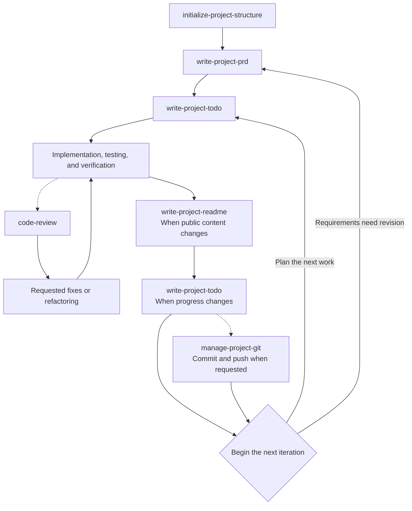

# Codex Project Workflow Skills

[繁體中文](README.md)

This repository collects personal Codex Skills for project and Git initialization, requirements, implementation planning, README and project-document maintenance, cross-session handoffs, commits and uploads, code review, refactoring, and a separately installed UI/UX design skill.

## Skill Sources

| Skill | Source | Description |
|---|---|---|
| `initialize-project-structure` | Authored for this repository | Creates a safe, minimal, technology-agnostic project structure |
| `write-project-prd` | Authored for this repository | Creates or incrementally updates product requirements |
| `write-project-todo` | Authored for this repository | Converts requirements into an actionable, verifiable local implementation plan |
| `write-project-readme` | Authored for this repository | Maintains synchronized Chinese and English README files from repository facts |
| `manage-project-docs` | Authored for this repository | Classifies, consolidates, and checks independent publication value for docs |
| `manage-project-handoff` | Authored for this repository | Creates private handoff snapshots and safely restores cross-session project context |
| `manage-project-git` | Authored for this repository | Safely initializes Git and handles normal commits and pushes, stopping on exceptions |
| `code-review` | External skill with personal modifications | The original source is currently unconfirmed; reviews code without editing it |
| `ui-ux-pro-max` | External skill | From [nextlevelbuilder/ui-ux-pro-max-skill](https://github.com/nextlevelbuilder/ui-ux-pro-max-skill); install separately |

Except for the skills explicitly identified as external or adapted above, the remaining skills were authored by this repository's owner.

## Project Workflow

This diagram shows an optional development cycle, not automatic skill chaining. Update only documentation affected by the current work:



Use `manage-project-docs` and `manage-project-git` when documentation cleanup or Git delivery is needed; ordinary code changes do not require updating every document.

Use `manage-project-handoff` independently when switching sessions to preserve a private short-term snapshot. The next session must revalidate it against the current repository.

## Skills

### `initialize-project-structure`

Creates a minimal, technology-agnostic project scaffold in an empty directory:

- Creates Chinese and English README files, `TODO.md`, `docs/PRD.md`, `docs/.gitkeep`, the local private directory `docs/private/`, and `src/`.
- Creates a generic `.gitignore` that excludes `TODO.md`, `docs/PRD.md`, and `docs/private/` by default; publishing a specific PRD or TODO requires explicit authorization and sensitivity review.
- Explicitly reports the Git tracking state of TODO, PRD, and the private directory after initialization. `docs/private/` has no `.gitkeep`, so consuming skills may need to recreate it compatibly after a clone.
- Validates the directory first to avoid overwriting existing content.
- Does not choose a language, framework, license, or package manager, and does not initialize Git.

### `write-project-prd`

Creates or updates `docs/PRD.md` from user requirements, existing documents, and repository content:

- Defines the problem, goals, scope, and functional and non-functional requirements.
- Uses stable `FR-XXX` IDs and verifiable acceptance criteria.
- Separates confirmed, planned, and open information.
- Preserves valid requirements through incremental updates without breaking down implementation tasks or writing code.
- Keeps the PRD local, private, and Git-ignored by default; it adds a missing rule incrementally and stops on unconfirmed existing tracking.

### `write-project-todo`

Converts the PRD and current project state into a local `TODO.md`:

- Defaults to a lightweight checklist; uses stable `TASK-XXX` IDs when traceability or complex collaboration needs them.
- Checks ordering, cycles, and blockers only when real dependencies exist.
- Marks tasks complete only with credible evidence.
- Completing a TASK does not mean its FR has passed acceptance.
- Does not modify the PRD or execute tasks automatically.
- Keeps TODO local, private, and Git-ignored by default; it reviews internal tracking and sensitive content before any explicit publication.

### `write-project-readme`

Creates or synchronizes `README.md` and `README.en.md` from actual repository content:

- Inspects code, configuration, tests, documentation, attribution, and release information.
- Keeps the Traditional Chinese and English versions semantically equivalent.
- Writes for users and new developers, highlighting key features in concise bullets; lengthy architecture, setup, and parameter details can move to linked public documents.
- Evaluates whether a change deserves documentation and updates existing explanations instead of adding a record for every edit.
- Distinguishes implemented, planned, and unconfirmed content.
- Preserves accurate human-written content through incremental updates without inventing features, versions, links, or test results.
- Treats TODO, PRD, and `docs/private/` as private inputs and creates only a minimal public projection independently supported by public evidence.

### `manage-project-docs`

Inventories `docs/` as public and worth keeping, private and worth keeping, needs organization, or proposed for removal:

- Reports each file's summary, classification, Git state, key risks, and concrete proposal.
- Public documents must be independently readable without private TODOs or PRDs, useful to readers, verified, and discoverable.
- Merges, moves, deletions, and publication or ignore changes require approval of the concrete plan. Formatting and explicitly requested small non-destructive edits can proceed directly.
- Follows existing structure without empty categories, preserves unique decision rationale, and repairs links after moves.
- Protects `docs/PRD.md` and `docs/private/HANDOFF.md`; reuses or repairs private storage only within the approved scope.
- Stops on credentials and recommends revocation or rotation; ignore rules do not untrack files or erase history.

### `manage-project-handoff`

Creates, updates, or reads `docs/private/HANDOFF.md`:

- Maintains one current short-term snapshot of active user constraints, decision rationale, unfinished work, blockers, and next steps.
- References PRD, TODO, README, and durable rules without copying or automatically updating them.
- Includes Git state and verification when useful, and rechecks current facts when resuming.
- A handoff request does not authorize implementation, commits, or pushes; snapshots contain no credentials and are never published directly.
- Ignored snapshots do not sync across devices automatically; private storage is repaired only when creating a snapshot needs it.

### `manage-project-git`

Handles first initialization, scoped commits, and uploads:

- The normal workflow checks state, diffs, secrets, and relevant verification before exact staging, committing, and pushing.
- The main file contains the ordinary workflow; `references/` covers only first initialization and exceptions.
- Commits and pushes require explicit authorization. Confirm the commit message, scope, and push target once before committing; other authorized routine steps avoid repeated confirmation and automatic documentation or review chains.
- Protects TODO, PRD, and private storage; inspects staged content and all outgoing commits, including exposure in intermediate commits.
- Stops on secrets, mixed staged content, conflicts, divergence, or material verification failures for the user to choose a remedy; never rewrites history or force-pushes automatically.

### `code-review`

Reviews code for correctness, security, performance, architecture, and maintainability:

- Reports evidence-backed findings by severity with trigger conditions, locations, impact, and remediation guidance.
- Provides suggestions or diff examples without changing files or Git state, and never starts refactoring automatically.
- Applies Dart and Flutter guidance conditionally from project configuration instead of forcing architecture, lint packages, or dependency upgrades.

This skill was adapted from an external version and personally modified; its original source is currently unconfirmed.

### `ui-ux-pro-max`

A UI/UX design assistance skill from [nextlevelbuilder/ui-ux-pro-max-skill](https://github.com/nextlevelbuilder/ui-ux-pro-max-skill). This repository stores only its source link; follow the upstream instructions to install it separately.

## Directory Structure

```text
.
├── initialize-project-structure/
├── write-project-prd/
├── write-project-todo/
├── write-project-readme/
├── manage-project-docs/
├── manage-project-handoff/
├── manage-project-git/
├── code-review/
├── AGENTS.md
├── README.md
└── README.en.md
```

Each skill contains a Traditional Chinese `SKILL.md` and `agents/openai.yaml`, with `references/` when useful. English skill copies are no longer maintained; project READMEs remain bilingual.

## Installation and Usage

Copy or link each complete skill folder you need into the personal skills directory recognized by your Codex installation. This environment uses `%USERPROFILE%\.codex\skills\`; verify the recognized location for other installations. Keep each skill's `agents/` and referenced resources; do not copy the whole repository or overwrite unrelated installed skills. Links reflect local edits directly; restart Codex if changes do not appear.

Example prompts:

```text
Use $write-project-todo to update tasks affected by the current work.
Use $code-review to review the current diff without editing files.
```

The repository's root [AGENTS.md](AGENTS.md) governs this repository; copying or linking skills does not automatically apply it to other projects. Merge applicable rules into the target project's `AGENTS.md` or your personal `%USERPROFILE%\.codex\AGENTS.md`, preserving existing guidance instead of replacing it. Each skill retains essential privacy, authorization, and read-only constraints and remains safe without this additional deployment.

Copied skills need to be synchronized after updates; linked skills use the source files directly. Check the skill list afterward to verify what is loaded.

### Same-turn Questions Outside Plan Mode (Optional)

To let Codex use `request_user_input` for selectable options or input fields outside Plan mode, first enable it in your personal `~/.codex/config.toml` (Windows: `%USERPROFILE%\.codex\config.toml`):

```toml
[features]
default_mode_request_user_input = true
```

If `[features]` already exists, add the setting there without duplicating the section or replacing other settings. Restart Codex afterward and verify support in your version and interface.

This flag is still under development and support may vary by version and interface. It does not replace system permission approvals. If disabled, unavailable, or disallowed for the question, skills can fall back to ordinary conversation; other functionality does not require enabling it. [Official configuration schema](https://developers.openai.com/codex/config-schema.json)

## Shared Design Principles

- Skills maintain only Traditional Chinese `SKILL.md`; READMEs remain semantically equivalent in both languages.
- Use skills independently when needed, without unrelated automatic chains. Request refactoring directly from Codex under the shared rules.
- YAML `name` values use English kebab-case; commands, paths, and identifiers remain unchanged.
- Use existing context and repository facts first; never invent requirements, implementation, versions, progress, or verification results.
- Keep durable rules, product requirements, implementation planning, session handoff, code changes, and public documentation responsibilities separate.
- Prefer incremental updates that preserve accurate and useful human-written content.
