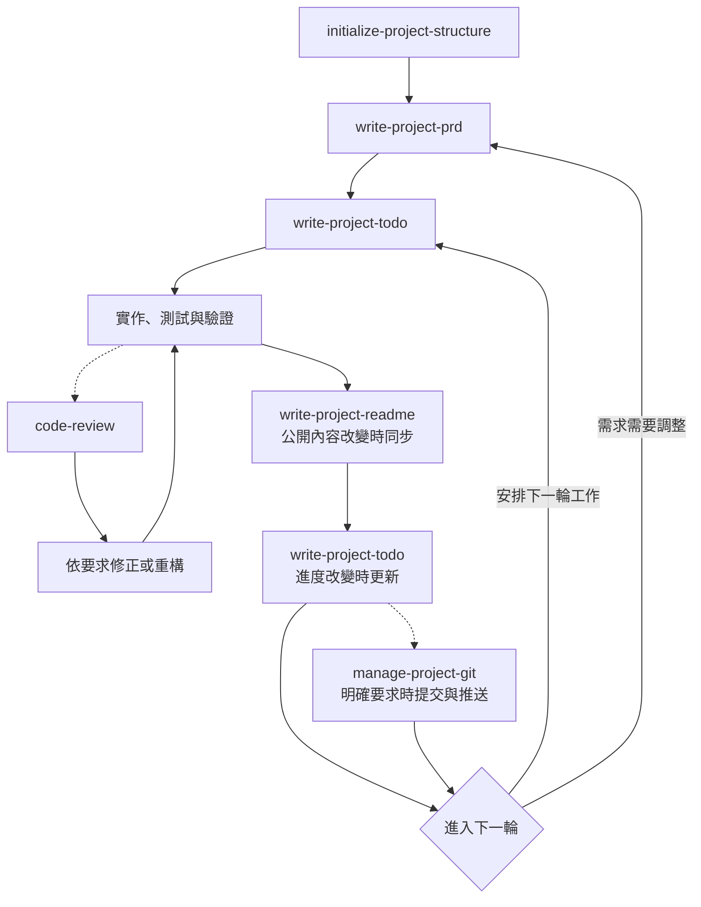

# Codex 專案工作流程 Skills

[English](README.en.md)

本儲存庫整理個人使用的 Codex Skills，涵蓋專案與 Git 初始化、需求文件、實作規劃、README 與專案文件維護、跨 session 交接、提交上傳、程式碼審查、重構，以及需另外安裝的 UI/UX 設計 Skill。

## Skill 來源

| Skill | 來源 | 說明 |
|---|---|---|
| `initialize-project-structure` | 自行撰寫 | 建立安全、最小且技術無關的專案初始架構 |
| `write-project-prd` | 自行撰寫 | 建立或增量更新產品需求文件 |
| `write-project-todo` | 自行撰寫 | 將需求轉換成可執行、可驗證的本機實作規劃 |
| `write-project-readme` | 自行撰寫 | 根據儲存庫事實同步維護中英文 README |
| `manage-project-docs` | 自行撰寫 | 分類、整合並檢查 docs 的獨立公開價值 |
| `manage-project-handoff` | 自行撰寫 | 建立私有交接快照並安全恢復跨 session 專案脈絡 |
| `manage-project-git` | 自行撰寫 | 安全初始化 Git，以正常流程提交推送，異常時停止 |
| `code-review` | 外部 Skill 經個人微調 | 原始來源目前未確認；僅進行審查，不直接修改程式碼 |
| `ui-ux-pro-max` | 外部 Skill | 來自 [nextlevelbuilder/ui-ux-pro-max-skill](https://github.com/nextlevelbuilder/ui-ux-pro-max-skill)，需另外安裝 |

除上表明確標示的外部或改作 Skill 外，其餘 Skill 均為本儲存庫作者自行撰寫。

## 專案工作流程

下圖是按需選用的開發循環，不代表 Skill 會自動串接。只更新本次受影響的文件：



文件整理與 Git 交付按需使用 `manage-project-docs` 與 `manage-project-git`；一般程式修改不要求更新所有文件。

`manage-project-handoff` 在需要切換 session 時獨立使用，保存私有短期快照；新 session 仍需核對目前儲存庫。

## Skills

### `initialize-project-structure`

在空白目錄建立最小化、技術無關的專案骨架：

- 建立中英文 README、`TODO.md`、`docs/PRD.md`、`docs/.gitkeep`、本機私有目錄 `docs/private/` 與 `src/`。
- 建立通用 `.gitignore`，預設排除 `TODO.md`、`docs/PRD.md` 與 `docs/private/`；特定 PRD／TODO 公開例外需明確授權及敏感內容檢查。
- 初始化完成時明確說明 TODO、PRD 與私有目錄的 Git 追蹤狀態；`docs/private/` 不放 `.gitkeep`，因此 clone 後可能需由使用它的 Skill 相容補建。
- 初始化前檢查目錄，避免覆寫既有內容。
- 不選擇程式語言、框架、授權或套件管理工具，也不初始化 Git。

### `write-project-prd`

根據使用者需求、既有文件與儲存庫內容建立或更新 `docs/PRD.md`：

- 定義問題、目標、範圍、功能與非功能需求。
- 使用穩定的 `FR-XXX` ID 與可驗證驗收條件。
- 區分已確認、規劃與待確認資訊。
- 保留有效需求並採增量更新，不拆解實作任務或撰寫程式碼。
- PRD 預設保持本機私有與 Git 忽略；缺少規則時增量補上，既有追蹤未經確認時先停止。

### `write-project-todo`

將 PRD 與目前專案狀態轉換成本機 `TODO.md`：

- 預設使用輕量勾選清單；需求追蹤或複雜協作時才使用穩定 `TASK-XXX` ID。
- 只有實際存在依賴時才檢查排序、循環及阻塞。
- 只有存在可信證據時才標記任務完成。
- TASK 完成不等於對應 FR 已通過驗收。
- 不修改 PRD，也不自動執行任務。
- TODO 預設保持本機私有與 Git 忽略；明確公開前先檢查內部追蹤與敏感內容。

### `write-project-readme`

根據儲存庫的實際內容建立或同步 `README.md` 與 `README.en.md`：

- 檢查程式碼、設定、測試、文件、引用與發布資訊。
- 保持繁體中文與英文版本語意一致。
- 面向一般使用者與新開發者，以簡潔條列精選重點功能；長篇架構、安裝與參數說明可拆成公開文件並連結。
- 先判斷變更是否有文件價值，優先修正既有說明，不把每次修改都新增成一項紀錄。
- 區分已實作、規劃中與未確認內容。
- 保留正確的人工內容並採增量更新，不虛構功能、版本、連結或測試結果。
- 將 TODO、PRD 與 `docs/private/` 視為私有輸入，只建立可由公開證據獨立理解的最小公開投影。

### `manage-project-docs`

盤點 `docs/`，分類為公開且可保留、私有且可保留、需要整理、建議移除：

- 逐檔回報簡介、分類、Git 狀態、關鍵風險與具體方案。
- 公開文件須能脫離私有 TODO／PRD 獨立閱讀，具讀者價值、已驗證內容與公開入口。
- 合併、搬移、刪除與公開／忽略變更須確認具體方案；純排版或明確指定的小幅非破壞性修改可直接處理。
- 沿用既有架構，不建立空分類；保留獨特決策理由，搬移後修正連結。
- 保護 `docs/PRD.md` 與 `docs/private/HANDOFF.md`；私有歸檔按核准範圍重用或補建私有邊界。
- 發現憑證時停止並建議撤銷／輪替；忽略規則不解除追蹤或清除歷史。

### `manage-project-handoff`

建立、更新或讀取 `docs/private/HANDOFF.md`：

- 維持單一最新短期快照，保存有效特殊要求、決策理由、未完成工作、阻塞與下一步。
- 引用 PRD、TODO、README 與長期規範，不複製全文或自動更新它們。
- Git 狀態與驗證結果只在有助接手時加入，恢復時重新核對現況。
- 只要求交接不代表授權實作、提交或推送；不記錄憑證、不直接公開。
- 被忽略的快照不會自動跨裝置同步；建立時才按需要補建私有邊界。

### `manage-project-git`

統一首次初始化、指定範圍提交與上傳：

- 正常流程直接檢查狀態、差異、機密及必要驗證，再精確暫存、提交與推送。
- 主檔包含一般路徑，`references/` 僅保留首次初始化與異常處理。
- 提交／推送須有明確授權；提交前確認一次 commit message、範圍與推送目標，其餘已授權正常步驟不反覆確認，也不自動串接文件或審查 Skill。
- 保護 TODO、PRD 與私有目錄；檢查 staged 及所有 outgoing commits，包括中間提交的暴露風險。
- 機密、混合暫存、衝突、分歧或重要驗證失敗時停止，由使用者選擇方案；不自動重寫歷史或強制推送。

### `code-review`

針對正確性、安全性、效能、架構與可維護性進行程式碼審查：

- 依證據與嚴重程度整理問題、觸發條件、位置、影響及改善方向。
- 提供建議或差異範例，但不修改檔案或 Git 狀態，也不自動啟動重構。
- Dart／Flutter 清單依專案設定條件式套用，不強迫特定架構、lint 套件或相依升級。

此 Skill 由外部來源版本經個人微調而成；原始來源目前未確認。

### `ui-ux-pro-max`

UI/UX 設計輔助 Skill，來源為 [nextlevelbuilder/ui-ux-pro-max-skill](https://github.com/nextlevelbuilder/ui-ux-pro-max-skill)。本儲存庫只保留來源連結，使用前需依上游說明自行安裝。

## 目錄結構

```text
.
├── initialize-project-structure/
├── write-project-prd/
├── write-project-todo/
├── write-project-readme/
├── manage-project-docs/
├── manage-project-handoff/
├── manage-project-git/
├── code-review/
├── AGENTS.md
├── README.md
└── README.en.md
```

每個 Skill 包含繁體中文 `SKILL.md` 與 `agents/openai.yaml`，必要時使用 `references/`；不再維護英文 Skill 副本。專案 README 仍維持中英文同步。

## 安裝與使用

將需要的完整 Skill 資料夾複製或連結到目前 Codex 使用的個人 skills 目錄。本環境使用 `%USERPROFILE%\.codex\skills\`；其他安裝方式請以實際可辨識的目錄為準。保留各 Skill 的 `agents/` 與引用資源，不複製整個倉庫或覆寫其他已安裝 Skill。連結可讓本地修改直接反映；未刷新時重新啟動 Codex。

例如輸入：

```text
使用 $write-project-todo 更新本次受影響的任務。
使用 $code-review 唯讀審查目前 diff。
```

倉庫根目錄 [AGENTS.md](AGENTS.md) 只管理本倉庫，不會因複製／連結 Skill 而自動套用到其他專案。跨專案需要共通規則時，將適用條目合併到目標專案的 `AGENTS.md`，或個人的 `%USERPROFILE%\.codex\AGENTS.md`；保留既有規範，不整份覆寫。各 Skill 已保留必要的隱私、授權及唯讀限制，不依賴這項額外部署才能安全使用。

複製安裝的 Skill 需在更新後重新同步；連結安裝直接使用來源內容。更新後可用 Skill 清單確認載入結果。

### 非 Plan 模式的同輪提問（選用）

若希望 Codex 在非 Plan 模式使用 `request_user_input` 顯示選項或輸入欄，請先在個人 `~/.codex/config.toml`（Windows：`%USERPROFILE%\.codex\config.toml`）啟用：

```toml
[features]
default_mode_request_user_input = true
```

已有 `[features]` 時只加入該設定，不重複建立區段或覆寫其他內容。設定後重新啟動 Codex，確認目前版本與介面支援。

此旗標仍屬開發中功能，版本與介面可能有差異；它不取代系統權限授權。未啟用、工具不可用或不允許該用途時，Skill 仍可改用一般對話確認，無須為了使用其他功能強制開啟。[官方設定 Schema](https://developers.openai.com/codex/config-schema.json)

## 共同設計原則

- Skill 僅維護繁體中文 `SKILL.md`；README 維持雙語等價。
- Skill 按需獨立使用，不自動串接無關流程；重構可直接交給 Codex，遵守共通規範。
- YAML `name` 使用英文 kebab-case；指令、路徑與識別字保留原文。
- 先使用既有上下文與儲存庫事實，不虛構需求、實作、版本、進度或驗證結果。
- 明確分離長期規範、產品需求、實作規劃、session 交接、程式碼修改與公開文件的責任。
- 優先採增量更新，保留仍正確且有用的人工內容。
